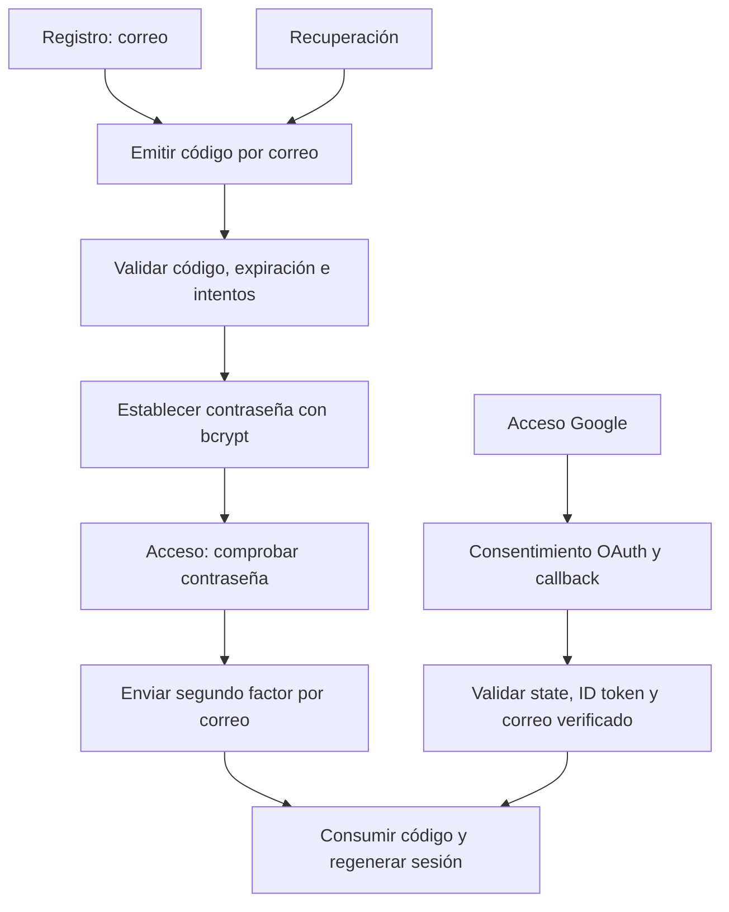

# Implementación y análisis de autenticación de dos pasos

Integrantes: **por completar**. Fecha: **por completar**.

## Arquitectura y configuración

Aplicación PHP → PDO → MariaDB; PHP → PHPMailer → SMTP. Google OAuth usa redirección de navegador y canje de código en el backend.

En registro y recuperación se establece la contraseña después de validar el código. En acceso local, se verifica primero la contraseña y después el OTP. Son propósitos diferentes y no se pueden intercambiar sus códigos. Solo el acceso OTP completado o el acceso federado crean la sesión autenticada.

El esquema SQL completo está en `database/schema.sql`: `id`, `email` único, `password_hash` nullable para Google, `telefono` opcional, `google_id` único, `codigo_verificacion`, `codigo_expiracion`, `cuenta_activa`, propósito, intentos y fecha de emisión. `limites` registra intentos por IP y correo en ventanas de quince minutos. La aplicación usa UTC.

Configuración SMTP real y OAuth: seguir README. **Insertar capturas propias de pantalla de consentimiento, redirección autorizada y configuración SMTP sin mostrar secretos.**

## Evidencias de funcionamiento

Completar con capturas y resultados reales:

1. Registro y mensaje recibido (identificar si es Mailpit local o proveedor externo).
2. Código validado y contraseña establecida.
3. Consulta `SELECT id,email,cuenta_activa,password_hash FROM usuarios;`: mostrar prefijo bcrypt, sin contraseñas en texto plano. Un hash es información sensible; usar una cuenta exclusiva de pruebas.
4. Inicio con contraseña correcta: no se concede acceso antes de OTP; acceso después de validar OTP.
5. Recuperación y rechazo de la contraseña anterior.
6. Código incorrecto, caducado, consumido y quinto intento fallido rechazados.
7. Google: consentimiento, regreso al callback y sesión autenticada; comprobar `google_id` sin contraseña local.

Google y SMTP externo requieren cuentas y credenciales del equipo. No deben calificarse como verificados sin ejecutar esos pasos.

## Ingeniería social y evasión

### Phishing mediante proxy inverso

Un sitio falso puede retransmitir en tiempo real la interacción con el portal legítimo. Si la víctima introduce contraseña y OTP en ese sitio, ambos pueden usarse mientras siguen vigentes. La sesión emitida después de MFA es una credencial de portador: su robo permite suplantar al usuario mientras sea válida. La caducidad y el uso único reducen repetición, pero no impiden retransmisión inmediata. HTTPS cifra el enlace con el dominio visitado; no demuestra que ese dominio sea el esperado. Cookies HttpOnly mitigan lectura por JavaScript en el origen, no interceptación en un intermediario que participa en el flujo. Este análisis no requiere desplegar un proxy de ataque ni capturar sesiones reales.

Mitigaciones: WebAuthn/FIDO2, revisión del dominio, detección de sesiones anómalas, revocación y autenticación reforzada para operaciones sensibles. Los códigos por correo no son resistentes al phishing y dependen de la seguridad de la cuenta de correo.

### SIM swapping, SMS y WhatsApp

Una transferencia fraudulenta del número puede redirigir SMS al atacante. La recuperación de cuentas ligada al número también puede verse afectada. WhatsApp no transporta todos sus mensajes como SMS: el riesgo incluye el proceso de registro/recuperación del número, dispositivos vinculados comprometidos o robo de sesiones; un cambio de SIM por sí solo no garantiza acceso a todo el historial o sesiones existentes.

WebAuthn/FIDO2 usa claves asimétricas vinculadas al identificador del servicio y al origen del navegador. El autenticador firma un desafío para el servicio esperado, de modo que un dominio falso no puede pedir una firma válida para otro origen. No transmite un secreto reutilizable ni un OTP que pueda retransmitirse. Sus mecanismos de recuperación deben conservar esa protección.

### Fatiga de notificaciones

Las solicitudes repetidas, urgencia simulada o una llamada que se hace pasar por soporte pueden llevar al usuario a aprobar por cansancio, confusión o para que cesen los avisos. Un simple botón “aceptar” carece de contexto suficiente. Se recomienda limitar frecuencia, mostrar datos del acceso, usar coincidencia numérica, facilitar rechazo y denuncia, y preferir factores resistentes al phishing. El flujo implementado exige introducir un código y limita emisiones; no usa notificaciones push y por tanto no demuestra un ataque push.

## Código fuente

Repositorio previsto: https://github.com/libi108/Autenticaci-n (el envío de estos archivos a GitHub debe realizarse aparte).

Fragmentos clave: `otp()` y `validCode()` en `src/security.php`, `sendCode()` en `src/bootstrap.php`, validación transaccional y bcrypt en `public/index.php`, verificación OAuth en `public/callback.php`.

## Referencias

- PHP: https://www.php.net/manual/en/function.password-hash.php
- PHPMailer: https://github.com/PHPMailer/PHPMailer
- Google OpenID Connect: https://developers.google.com/identity/openid-connect/openid-connect
- WebAuthn: https://www.w3.org/TR/webauthn-3/
- OWASP MFA Cheat Sheet: https://cheatsheetseries.owasp.org/cheatsheets/Multifactor_Authentication_Cheat_Sheet.html
