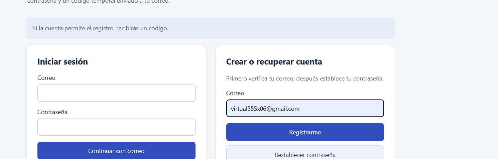
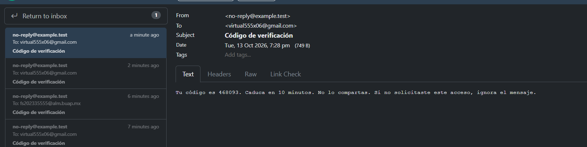
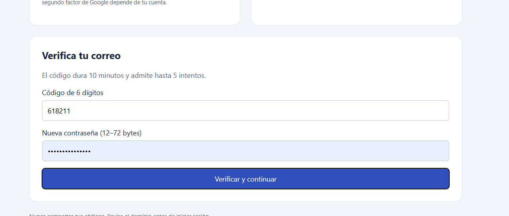
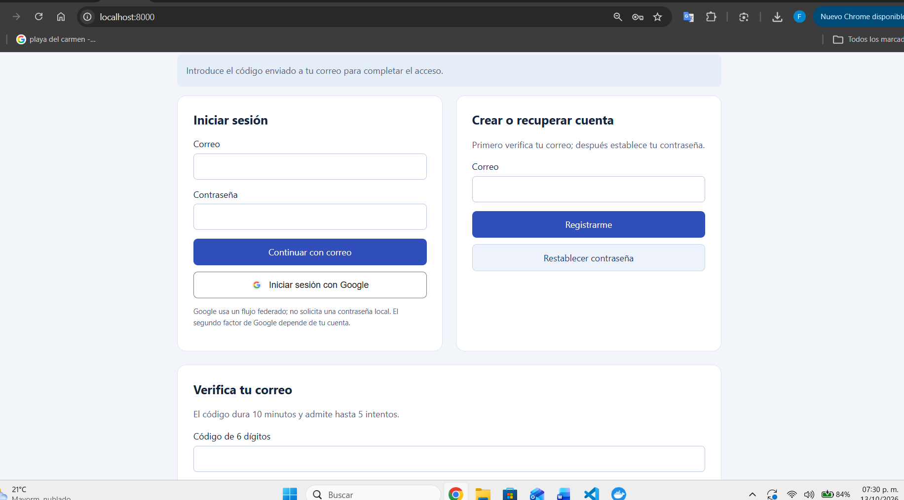
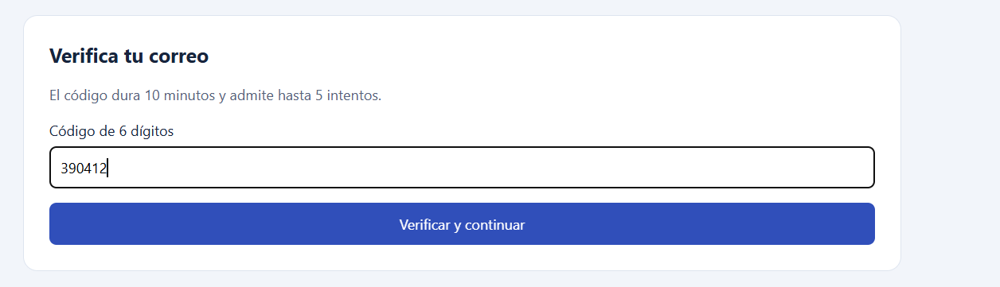
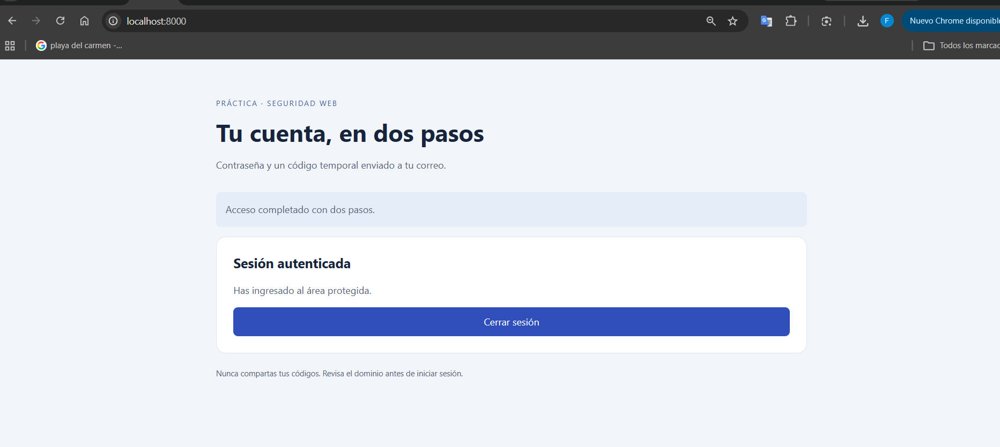
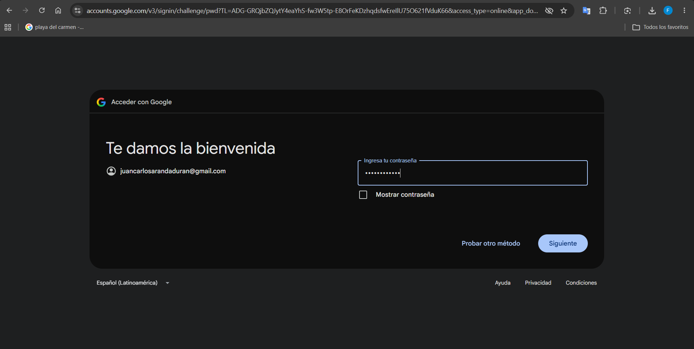
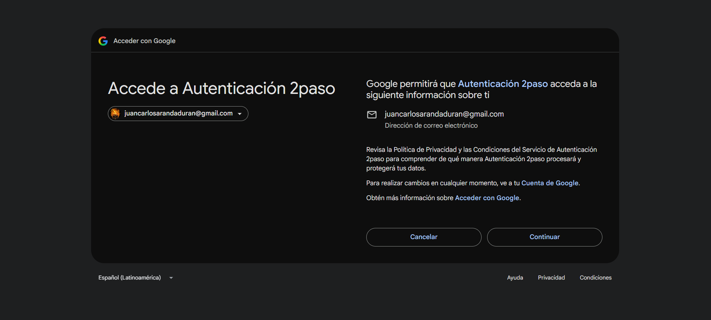
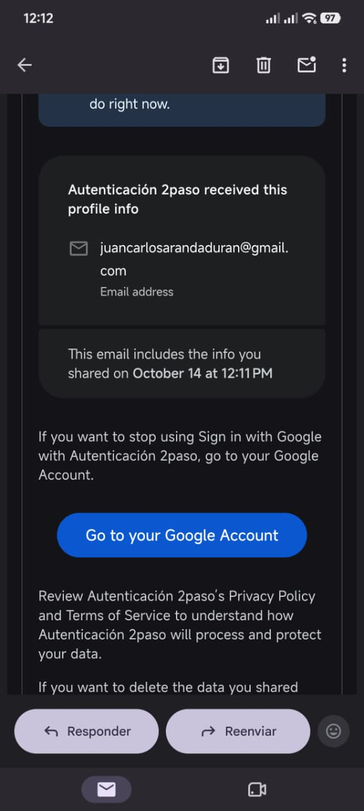
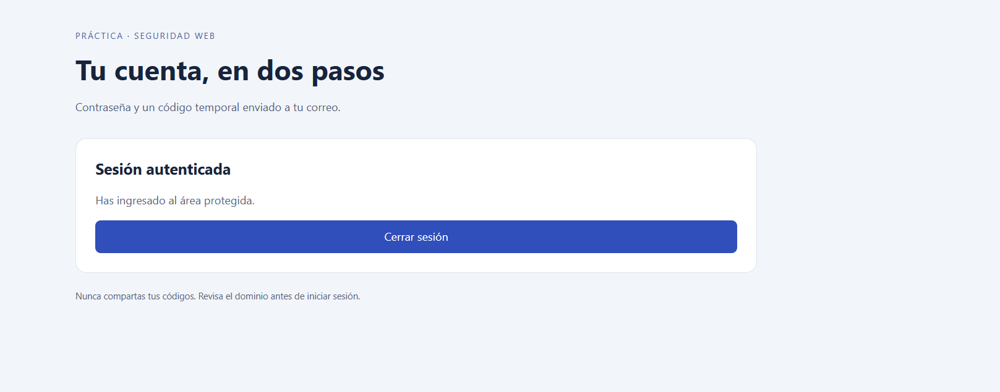

# Implementación y Análisis de Autenticación de Dos Pasos (2FA)

Juan Carlos Aranda Flores – 202369781

Fatima Flores Santos – 202335555


## 1. Introducción

El presente reporte documenta la implementación y los resultados de una aplicación de autenticación desarrollada con PHP, MariaDB, PHPMailer y Google OAuth 2.0. Se implementaron dos formas de acceso: autenticación local mediante contraseña y código temporal por correo, y autenticación federada mediante una cuenta Google.

El objetivo de la práctica fue integrar un mecanismo funcional de verificación por correo, gestionar contraseñas mediante hash, incorporar el acceso Google y analizar los riesgos de ingeniería social asociados a estos métodos. Las evidencias muestran el registro, la recepción de códigos, su introducción en la aplicación y el acceso al área protegida mediante ambos flujos.


## 2. Arquitectura y Descripción del Flujo


### 2.1 Componentes del sistema

Docker Compose ejecuta la aplicación PHP 8.3, MariaDB 11.4 y Mailpit. PDO conecta PHP con la base de datos mediante consultas preparadas. PHPMailer entrega los mensajes al servidor SMTP local Mailpit, cuya interfaz permite consultar los códigos de la práctica. El cliente Google gestiona el intercambio OAuth y verifica la identidad antes de crear la sesión.


### 2.2 Diferencia entre los dos métodos de acceso

En el acceso local, la aplicación comprueba una contraseña propia y exige después un código temporal enviado por correo. En el acceso federado, Google autentica al usuario y devuelve a la aplicación una identidad verificada. No se crea una contraseña local ni se envía un código adicional desde la aplicación para ese flujo. Si Google ya tiene una sesión válida, puede reconocer al usuario sin pedirle de nuevo su contraseña; las pantallas de Google dependen del estado y de la configuración de su cuenta.

Esta distinción permite interpretar las evidencias: el aviso de Google sobre información compartida corresponde a autorización del acceso federado; el correo de PHPMailer contiene el OTP del flujo local. La sesión autenticada es el resultado final de ambos caminos, pero la comprobación local de dos pasos se demuestra con contraseña y OTP.


## 3. Evidencias del Registro y Acceso Local


### 3.1 Solicitud de registro

El usuario escribe su correo en Crear o recuperar cuenta y pulsa Registrarme. La aplicación muestra el aviso de envío y comienza la verificación del correo antes de permitir establecer una contraseña.



Figura 1. Solicitud de registro.


### 3.2 Recepción del mensaje con el código

El buzón Mailpit muestra el correo generado por PHPMailer, con asunto Código de verificación y un código de seis dígitos. El mensaje señala una duración de diez minutos y recomienda no compartirlo. Mailpit funciona como receptor SMTP local para observar el envío durante el laboratorio.



Figura 2. Recepción del mensaje con el código.


## 3. Evidencias del Registro y Acceso Local (continuación)


### 3.3 Verificación y establecimiento de contraseña

En Verifica tu correo se introduce el código recibido y una nueva contraseña. Al pulsar Verificar y continuar, el backend valida el código y guarda la contraseña con password_hash y PASSWORD_BCRYPT. De esta manera, la contraseña se establece después de comprobar el acceso al canal de correo.



Figura 3. Verificación y establecimiento de contraseña.


### 3.4 Inicio de sesión y solicitud del segundo factor

Una vez creada la cuenta, el usuario introduce correo y contraseña en Iniciar sesión. La aplicación comprueba la credencial y muestra Introduce el código enviado a tu correo para completar el acceso. El inicio de sesión queda condicionado a la segunda verificación.



Figura 4. Inicio de sesión y solicitud del segundo factor.


## 3. Evidencias del Registro y Acceso Local (continuación)


### 3.5 Validación del código de inicio de sesión

El usuario introduce el nuevo código en el formulario de verificación. Este formulario ya no incluye una nueva contraseña, porque corresponde al segundo paso de acceso a una cuenta existente. El código se valida en el backend y se consume para impedir su reutilización.



Figura 5. Validación del código de inicio de sesión.


### 3.6 Acceso completado en dos pasos

La aplicación muestra Acceso completado con dos pasos y Sesión autenticada. El usuario llega al área protegida y dispone de Cerrar sesión. La secuencia de las figuras documenta el resultado del acceso local con contraseña y código temporal.



Figura 6. Acceso completado en dos pasos.


## 4. Evidencias del Acceso Federado con Google


### 4.1 Autenticación de la cuenta Google

El acceso se inicia desde el botón Iniciar sesión con Google. La captura muestra una pantalla de Google para autenticar la cuenta seleccionada. Las credenciales de Google se introducen en el proveedor, no en el formulario local de la aplicación.



Figura 7. Autenticación de la cuenta Google.


### 4.2 Consentimiento e información compartida

Google muestra la aplicación Autenticación 2paso y la información de perfil solicitada. El usuario autoriza el acceso mediante Continuar. Esta pantalla corresponde al consentimiento para compartir la identidad con la aplicación.



Figura 8. Consentimiento e información compartida.


## 4. Evidencias del Acceso Federado con Google (continuación)


### 4.3 Aviso de Google sobre la autorización

El correo informa que Autenticación 2paso recibió la dirección de correo del usuario y permite revisar o retirar el acceso desde la cuenta Google. Es una notificación del proveedor sobre información compartida, no un código OTP. La autorización forma parte del flujo federado.



Figura 9. Aviso de Google sobre la autorización.


## 4. Evidencias del Acceso Federado con Google (continuación)


### 4.4 Regreso a la aplicación y sesión autenticada

Después de la autorización, el navegador regresa a la aplicación y muestra Sesión autenticada y Has ingresado al área protegida. En conjunto con las pantallas de autenticación y consentimiento, esta captura documenta el acceso Google completado. No se solicita contraseña local porque la identidad fue comprobada por el proveedor.



Figura 10. Regreso a la aplicación y sesión autenticada.


### 4.5 Funcionamiento del callback

La dirección de regreso del laboratorio es http://localhost:8000/callback.php. El backend comprueba el parámetro state asociado a la sesión, canjea el código de autorización y verifica el ID token de Google, incluido el correo verificado. Registra el identificador google_id y establece una sesión. El código de autorización es un dato del protocolo intercambiado entre el backend y Google, no un código que el usuario deba copiar del correo.

El acceso federado exitoso demuestra la integración OAuth. La exigencia de MFA por parte de Google depende de la configuración de la cuenta y no debe confundirse con el OTP local de la aplicación.


## 5. Implementación Técnica y Resultados


### 5.1 Estructura de la base de datos

```
CREATE TABLE IF NOT EXISTS usuarios (
 id BIGINT UNSIGNED AUTO_INCREMENT PRIMARY KEY,
 email VARCHAR(254) NOT NULL UNIQUE,
 password_hash VARCHAR(255) NULL,
 telefono VARCHAR(20) NULL,
 google_id VARCHAR(255) NULL UNIQUE,
 codigo_verificacion VARCHAR(128) NULL,
 codigo_expiracion DATETIME NULL,
 codigo_proposito VARCHAR(20) NULL,
 codigo_intentos INT NOT NULL DEFAULT 0,
 ultimo_envio DATETIME NULL,
 cuenta_activa BOOLEAN NOT NULL DEFAULT FALSE
);
```

email identifica la cuenta; password_hash almacena la contraseña local y puede ser nulo en cuentas Google; google_id identifica al usuario federado. Los campos de código registran hash, vencimiento, propósito e intentos. cuenta_activa representa el estado de la cuenta. La tabla adicional limites mantiene contadores persistentes por IP y correo.


### 5.2 Protección de códigos y contraseñas

```
$code = (string) random_int(100000, 999999);
$codeHash = hash('sha256', $code);
$passwordHash = password_hash($password, PASSWORD_BCRYPT);
$correct = password_verify($password, $passwordHash);
```

La implementación genera códigos mediante un generador criptográficamente seguro, aplica una vigencia de diez minutos y admite como máximo cinco intentos fallidos. Se compara el hash en el backend y se consume el código dentro de una transacción. La contraseña local se almacena como hash bcrypt, no como texto plano. La sesión se regenera al completar la autenticación.


## 5. Implementación Técnica y Resultados (continuación)


### 5.3 Resumen de resultados obtenidos

Los resultados documentados muestran que el mecanismo local exige sus dos verificaciones y que el acceso federado crea una sesión a partir de la identidad Google. El correo de autorización de Google y el OTP local tienen funciones diferentes y se observan por separado en las evidencias.


### 5.4 Código fuente

Repositorio: https://github.com/libi108/Autenticaci-n. Los archivos principales son src/security.php para códigos y validación, src/bootstrap.php para PHPMailer, PDO y cliente Google, public/index.php para los formularios y el acceso local, public/callback.php para OAuth y database/schema.sql para la persistencia.


## 6. Análisis de Ingeniería Social


### 6.1 Phishing con proxy inverso

Un portal falso puede retransmitir en tiempo real el flujo del servicio legítimo y utilizar la contraseña y el OTP mientras estén vigentes. Una sesión robada después de MFA puede actuar como credencial de portador. La vigencia corta y el consumo único reducen reutilización, pero no impiden la retransmisión inmediata. HTTPS protege la conexión con el dominio visitado; el usuario debe comprobar que ese dominio sea el esperado. WebAuthn/FIDO2 ofrece resistencia al phishing mediante credenciales vinculadas al origen.


### 6.2 SIM swapping y canales móviles

Una transferencia fraudulenta del número puede redirigir SMS y afectar la recuperación de cuentas basada en teléfono. En WhatsApp también influyen el registro del número, los dispositivos vinculados y el robo de sesiones; no equivale simplemente a recibir todos los mensajes por SMS. WebAuthn/FIDO2 utiliza claves asimétricas asociadas al servicio y no transmite un OTP reutilizable. Su recuperación debe mantener la misma protección.


### 6.3 Fatiga de notificaciones

La repetición de solicitudes, la urgencia y una llamada de supuesto soporte pueden inducir una aprobación por cansancio o confusión. Limitar la frecuencia, mostrar contexto, permitir rechazo y usar coincidencia numérica reduce ese riesgo. La aplicación implementada solicita introducción de un código y limita las emisiones; las notificaciones push se analizan como un vector diferente.


### 6.4 Medidas de prevención

Se recomienda revisar dominios, no compartir códigos, rechazar solicitudes no iniciadas y mantener segura la cuenta de correo. En el servicio, proteger secretos y sesiones, usar HTTPS, limitar intentos y emplear factores resistentes al phishing para operaciones sensibles complementa la autenticación implementada.


## 7. Conclusiones

Se logró el objetivo de la práctica: implementar una aplicación con verificación por correo, gestión de contraseñas mediante bcrypt e inicio de sesión federado con Google. Las evidencias documentan la recepción del OTP en el buzón de laboratorio, su introducción en la aplicación, el acceso local completado en dos pasos y el acceso Google hasta la sesión autenticada.

La práctica permitió comprender la diferencia entre verificación del correo durante el registro, segundo factor local al iniciar sesión y autenticación federada. Google comprueba la identidad del usuario sin exigir una contraseña propia de la aplicación; su aviso por correo informa de la autorización, mientras que el código enviado por PHPMailer pertenece al flujo local.

El análisis técnico muestra que los códigos temporales y las contraseñas con hash aportan controles útiles, pero la resistencia a ingeniería social requiere además atención al dominio, protección de la sesión y factores como WebAuthn/FIDO2. El resultado es un laboratorio funcional que integra ambos métodos de acceso y permite explicar sus características con evidencias reales.


## 8. Referencias

PHP — password_hash: https://www.php.net/manual/en/function.password-hash.php

PHPMailer: https://github.com/PHPMailer/PHPMailer

Google OpenID Connect: https://developers.google.com/identity/openid-connect/openid-connect

WebAuthn: https://www.w3.org/TR/webauthn-3/

OWASP — Multifactor Authentication Cheat Sheet: https://cheatsheetseries.owasp.org/cheatsheets/Multifactor_Authentication_Cheat_Sheet.html
