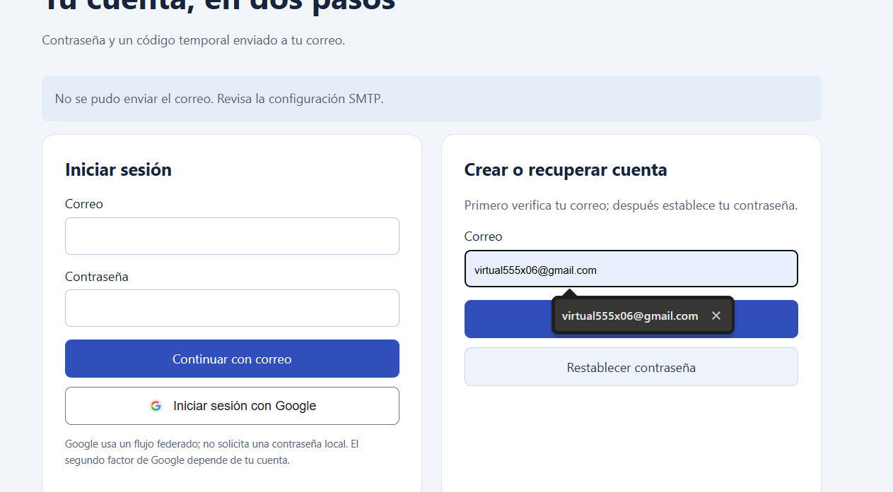

# Implementación y Análisis de Autenticación de Dos Pasos (2FA)

Juan Carlos Aranda Flores – 202369781

Fatima Flores Santos – 202335555


## 1. Introducción

El presente reporte documenta la implementación y prueba de una aplicación de autenticación de dos pasos desarrollada con PHP, MariaDB y PHPMailer. La práctica incluye registro local, establecimiento de contraseña después de verificar el correo, inicio de sesión con contraseña y código temporal, recuperación de contraseña e integración de acceso federado mediante Google OAuth 2.0.

El objetivo es comprobar el flujo funcional y analizar sus límites frente a ingeniería social. Las evidencias entregadas por el equipo muestran el registro, la recepción de mensajes en Mailpit, los formularios de validación y una sesión autenticada. Mailpit es un buzón SMTP de laboratorio: recibir allí un mensaje no demuestra su entrega a Gmail u otro proveedor externo.


## 2. Alcance de la Práctica y Manejo de Información

Las pruebas se realizaron en una aplicación de laboratorio accesible en localhost:8000, con un buzón local en localhost:8025. Se eligió el canal de correo electrónico; SMS y WhatsApp no se implementaron. El análisis de phishing, SIM swapping y fatiga de notificaciones es conceptual y defensivo; no se realizó una campaña de interceptación de credenciales.

La configuración se conserva en .env, excluido del repositorio. El archivo .env.example contiene nombres de variables y valores de ejemplo. Las contraseñas locales se almacenan con bcrypt; los códigos temporales se almacenan mediante un hash SHA-256. No deben incorporarse contraseñas ni secretos OAuth a las evidencias del reporte.

Se distinguen los resultados observados en las capturas del equipo, las comprobaciones automatizadas realizadas previamente y los componentes pendientes de validación externa. La presencia del botón Google no acredita un acceso OAuth exitoso.


## 3. Evidencias del Flujo de Autenticación


### 3.1 Registro de la cuenta

La captura del formulario de registro muestra el correo introducido y el mensaje: «Si la cuenta permite el registro, recibirás un código». Esta respuesta inicia el proceso de comprobación del correo; todavía no concede acceso al área protegida.


Figura 1. Registro de la cuenta.


### 3.2 Recepción del código en Mailpit

La captura del buzón muestra mensajes con asunto «Código de verificación», remitente no-reply@example.test y un código de seis dígitos. El cuerpo informa que caduca en diez minutos y que no debe compartirse. La recepción documenta envío SMTP local, no entrega a una bandeja Gmail.


Figura 2. Recepción del código en Mailpit.


## 3. Evidencias del Flujo de Autenticación (continuación)


### 3.3 Verificación y establecimiento de contraseña

La captura muestra «Verifica tu correo», el campo de código y el campo «Nueva contraseña (12–72 bytes)» con el valor oculto. El botón «Verificar y continuar» envía los datos al backend. Esta imagen acredita el formulario rellenado; por sí sola no muestra el hash almacenado en la base de datos.


Figura 3. Verificación y establecimiento de contraseña.


### 3.4 Solicitud del segundo factor después de la contraseña

La captura completa de la aplicación muestra el aviso «Introduce el código enviado a tu correo para completar el acceso» y el formulario de verificación. En este punto se ha solicitado el segundo factor y aún no se presenta el área protegida.


Figura 4. Solicitud del segundo factor después de la contraseña.


## 3. Evidencias del Flujo de Autenticación (continuación)


### 3.5 Introducción del código de acceso

La captura muestra el formulario de código de seis dígitos sin el campo de nueva contraseña, correspondiente al segundo factor de inicio de sesión. Se informa una vigencia de diez minutos y un máximo de cinco intentos.


Figura 5. Introducción del código de acceso.


### 3.6 Sesión autenticada

La captura final muestra «Acceso completado con dos pasos», «Sesión autenticada» y «Has ingresado al área protegida», además del botón para cerrar sesión. Es la evidencia visual del acceso local completado.


Figura 6. Sesión autenticada.


## 3. Evidencias del Flujo de Autenticación (continuación)


### 3.7 Incidencia de SMTP y corrección aplicada

La captura inicial muestra «No se pudo enviar el correo. Revisa la configuración SMTP». Se corrigió la configuración de Mailpit retirando usuario y contraseña, porque el servidor local de pruebas se usa sin autenticación y sin TLS. Las capturas posteriores del buzón y de la sesión documentan la continuidad del flujo después de la corrección.



Figura 7. Incidencia de SMTP y corrección aplicada.


### 3.8 Configuración del buzón local utilizada

```
SMTP_HOST=mail
SMTP_PORT=1025
SMTP_USER=
SMTP_PASSWORD=
SMTP_ENCRYPTION=none
SMTP_FROM=no-reply@example.test
```

La opción sin TLS está restringida por el código a servidores locales y sin credenciales. Para un proveedor SMTP externo se debe utilizar STARTTLS o SMTPS, credenciales del proveedor y verificación de certificados.


## 4. Evidencias Técnicas del Sistema


### 4.1 Arquitectura y flujo

Docker Compose ejecuta tres servicios: la aplicación PHP 8.3, MariaDB 11.4 y Mailpit. La aplicación recibe formularios HTTP, consulta la base de datos mediante PDO y envía códigos con PHPMailer. El flujo Google redirige al proveedor, canjea el código OAuth en el backend y verifica el ID token antes de iniciar sesión.


### 4.2 Estructura de la tabla usuarios

```
CREATE TABLE IF NOT EXISTS usuarios (
 id BIGINT UNSIGNED AUTO_INCREMENT PRIMARY KEY,
 email VARCHAR(254) NOT NULL UNIQUE,
 password_hash VARCHAR(255) NULL,
 telefono VARCHAR(20) NULL,
 google_id VARCHAR(255) NULL UNIQUE,
 codigo_verificacion VARCHAR(128) NULL,
 codigo_expiracion DATETIME NULL,
 codigo_proposito VARCHAR(20) NULL,
 codigo_intentos INT NOT NULL DEFAULT 0,
 ultimo_envio DATETIME NULL,
 cuenta_activa BOOLEAN NOT NULL DEFAULT FALSE
);
```

La tabla limites registra contadores por IP y correo en ventanas de quince minutos. codigo_proposito evita intercambiar códigos de registro, recuperación y acceso. ultimo_envio limita las emisiones para una misma cuenta a una por minuto.


## 4. Evidencias Técnicas del Sistema (continuación)


### 4.3 Generación, expiración y consumo del código

```
$code = (string) random_int(100000, 999999);
$hash = hash('sha256', $code);
// Se guarda el hash; expiración: UTC_TIMESTAMP() + 10 minutos.
// Se validan formato, propósito, expiración y menos de 5 intentos.
// SELECT ... FOR UPDATE protege el consumo transaccional.
// Al aceptar: codigo_verificacion y codigo_expiracion = NULL.
```

El código solo se acepta mientras está vigente y con menos de cinco fallos. El backend usa hash_equals para comparar el hash. La caducidad y consumo reducen la reutilización, aunque los seis dígitos tienen baja entropía y requieren límites de intentos y protección de la base de datos.


### 4.4 Gestión de contraseñas y sesiones

```
$hash = password_hash($password, PASSWORD_BCRYPT);
$ok = password_verify($password, $hash);
session_regenerate_id(true);
```

El hash de contraseña no es cifrado reversible. Se requieren entre doce y setenta y dos bytes para evitar el truncamiento de bcrypt. La validación del código precede al alta o cambio de contraseña. Se emplean consultas preparadas, formularios con CSRF, cookies HttpOnly y SameSite, y Secure cuando APP_URL utiliza HTTPS.


### 4.5 Google OAuth 2.0

Se configura un cliente web en GCP y se autoriza la redirección exacta http://localhost:8000/callback.php para el laboratorio. El backend valida state de uso único con caducidad, el ID token y el correo verificado. Guarda google_id y admite una contraseña local nula para cuentas federadas. No vincula automáticamente una cuenta local existente por coincidencia de correo.

No se aportó captura de consentimiento, de la configuración GCP ni de un acceso Google completado. Estos puntos quedan pendientes de evidencia. La autenticación federada tampoco prueba por sí sola que Google haya exigido un segundo factor al usuario.


### 4.6 Código fuente

Repositorio: https://github.com/libi108/Autenticaci-n. Archivos clave: src/security.php, src/bootstrap.php, public/index.php, public/callback.php y database/schema.sql.


## 5. Resultados y Validación

Las capturas del equipo documentan el recorrido manual local desde la solicitud de registro hasta la sesión autenticada. No permiten confirmar visualmente el almacenamiento bcrypt, la recuperación de contraseña ni el acceso federado. Por separado, la validación automatizada previa del entorno completó once comprobaciones de seguridad y dieciocho comprobaciones funcionales HTTP, base de datos y correo local.


### 5.1 Límites y pendientes

Los correos visibles fueron capturados por Mailpit. Se requiere una prueba independiente para demostrar entrega SMTP externa. También se necesitan capturas del hash bcrypt en MariaDB, de la recuperación y del acceso Google. No se presenta esta práctica como una solución de producción ni como una demostración de resistencia al phishing.


## 6. Análisis de Ingeniería Social y Mitigación


### 6.1 Phishing mediante proxy inverso

Un portal falso puede retransmitir en tiempo real la interacción con el servicio legítimo. Si la víctima entrega contraseña y OTP al intermediario, este puede usarlos durante su vigencia. La sesión emitida tras MFA actúa como credencial de portador; su robo puede permitir suplantación mientras sea válida. HTTPS protege la conexión con el dominio visitado, pero no garantiza que sea el dominio esperado. HttpOnly mitiga lectura de cookies por JavaScript del origen, no un intermediario que participa en el flujo. El uso único no evita la retransmisión inmediata.


### 6.2 SIM swapping y OTP por SMS o WhatsApp

Una transferencia fraudulenta de número puede dirigir SMS al atacante y afectar la recuperación de cuentas ligada al teléfono. WhatsApp tiene riesgos distintos: registro o recuperación del número, dispositivos vinculados comprometidos y robo de sesión. Un cambio de SIM no garantiza por sí solo acceso a todo el historial. WebAuthn/FIDO2 utiliza claves asimétricas ligadas al servicio y al origen; un dominio falso no puede solicitar una firma válida para el origen legítimo. Los procesos de recuperación deben conservar esa protección.


### 6.3 Fatiga de notificaciones

Las solicitudes repetidas y la presión de un supuesto soporte pueden provocar una aprobación por cansancio o confusión. Se recomienda limitar frecuencia, aportar contexto del intento y facilitar rechazo y denuncia. La coincidencia numérica mejora un simple botón de aceptación, aunque no equivale a resistencia al phishing. Esta aplicación usa introducción de OTP y límites de emisión, no notificaciones push.


### 6.4 Recomendaciones

Usuario: revisar el dominio, no compartir códigos y rechazar accesos no solicitados. Infraestructura: HTTPS, TLS para SMTP externo, protección de secretos, monitoreo y revocación de sesiones, límites en el perímetro y WebAuthn para accesos sensibles. Las medidas implementadas reducen ataques automatizados y reutilización, pero no eliminan la ingeniería social.


## 7. Conclusiones

La evidencia visual aportada demuestra un registro con verificación de correo y un acceso local completado en dos pasos. La incidencia SMTP inicial se resolvió usando correctamente Mailpit sin credenciales. El sistema separa los propósitos del código, aplica caducidad y límites de intentos, y concede acceso únicamente después del segundo factor local o de la autenticación federada validada.

Los códigos por correo agregan una barrera a la contraseña, pero pueden ser retransmitidos por phishing en tiempo real y dependen de la seguridad del buzón. La alternativa recomendada para resistencia al phishing es WebAuthn/FIDO2, acompañada de recuperación segura y capacitación del usuario. La entrega SMTP externa, las capturas del almacenamiento bcrypt y el acceso Google requieren evidencias adicionales antes de considerarse demostrados en el reporte.


## 8. Referencias

PHP — password_hash: https://www.php.net/manual/en/function.password-hash.php

PHPMailer: https://github.com/PHPMailer/PHPMailer

Google OpenID Connect: https://developers.google.com/identity/openid-connect/openid-connect

WebAuthn: https://www.w3.org/TR/webauthn-3/

OWASP — Multifactor Authentication Cheat Sheet: https://cheatsheetseries.owasp.org/cheatsheets/Multifactor_Authentication_Cheat_Sheet.html
